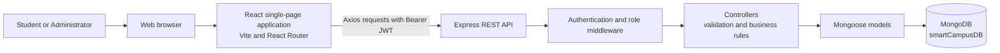
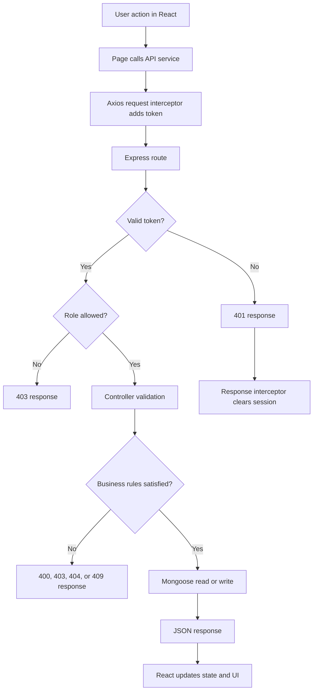
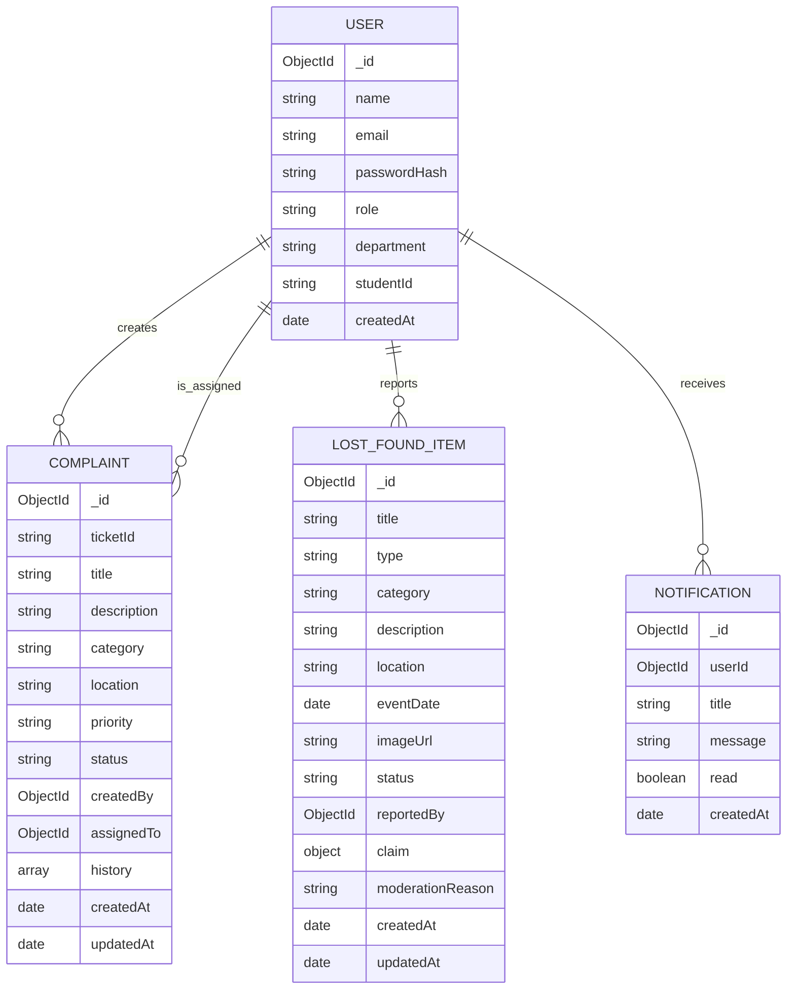
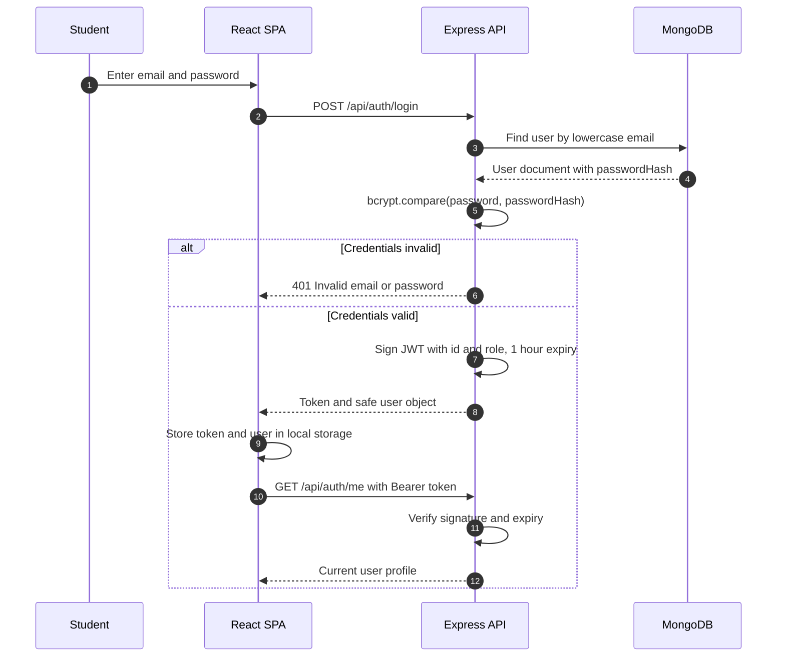
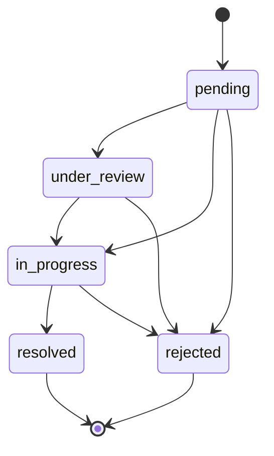
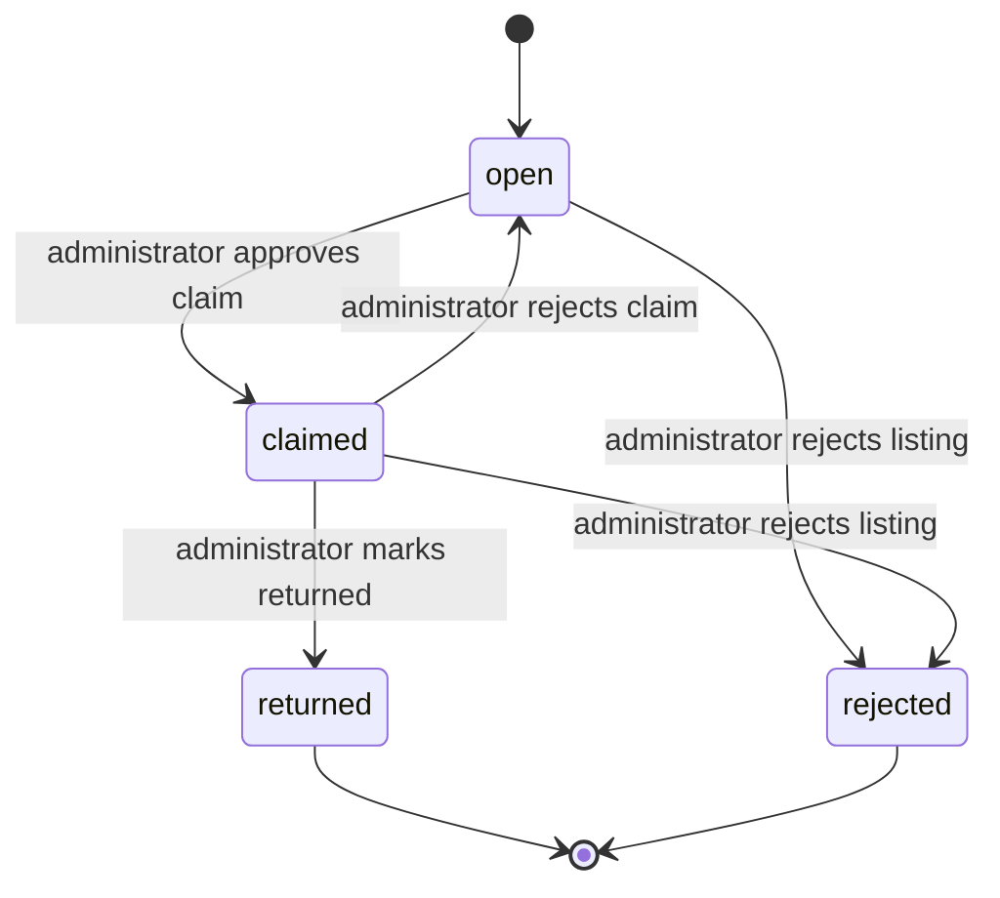

# Smart Campus Service Portal

## Project Report

**Course:** [Course Name]

**Student:** [Student Name]

**Roll Number:** [Roll Number]

**Department:** [Department Name]

**Institution:** [Institution Name]

**Guide:** [Guide Name]

**Academic Year:** [Academic Year]

---

## Declaration

I declare that this project report describes work carried out by me for the
Smart Campus Service Portal. The implementation described here is present in the
accompanying repository. External libraries and documentation used during
development are acknowledged in the References section. Screenshots have not
been fabricated; the screenshot section lists the screens to capture locally.

**Signature:** ____________________

**Date:** ____________________

---

## Acknowledgement

I thank my project guide and department for their guidance and support. I also
acknowledge the maintainers of the open-source tools used in this project,
including React, Vite, Express, MongoDB, Mongoose, JSON Web Token, bcryptjs,
Axios, and React Router.

---

## Abstract

Campus service requests are frequently handled through scattered messages,
paper forms, and informal conversations. This makes it difficult for students to
track whether an issue has been received or resolved, and it makes it difficult
for administrators to prioritise work or verify lost-and-found ownership claims.
This project implements a Smart Campus Service Portal that centralises complaint
management and lost-and-found reporting in a single role-based web application.

The system uses React and Vite for the frontend, Express for the REST API,
MongoDB with Mongoose for persistence, JSON Web Tokens for authentication, and
bcrypt for password hashing. Students can register, submit complaints, track
status history, report lost or found items, browse listings, and submit ownership
claims. Administrators receive a separate portal with live analytics, complaint
moderation, claim verification, listing moderation, and a user directory.

The project emphasises server-side enforcement of role, ownership, and workflow
rules. Allowed status transitions are validated in the API, rejected listings are
hidden from students, and claims require administrator approval before an item
can be marked returned. The final verification recorded 88 passing backend
integration tests, 25 passing browser end-to-end tests, 10 passing smoke tests, 58
passing API role and workflow checks, a successful production build, and a
successful lint run with nine non-blocking advisories. The report also documents
limitations such as the absence of refresh tokens, image uploads, a notification
centre, rate limiting, and committed automated tests.

**Keywords:** campus services, complaint management, lost and found, React,
Express, MongoDB, JWT, role-based access control, REST API.

---

## Table of Contents

1. [Introduction](#1-introduction)
2. [Literature and Existing System Review](#2-literature-and-existing-system-review)
3. [System Analysis and Requirements](#3-system-analysis-and-requirements)
4. [System Design](#4-system-design)
5. [Implementation](#5-implementation)
6. [Testing and Results](#6-testing-and-results)
7. [Security Analysis](#7-security-analysis)
8. [Limitations and Future Enhancements](#8-limitations-and-future-enhancements)
9. [Conclusion](#9-conclusion)
10. [References](#10-references)
11. [Appendix A: API Summary](#appendix-a-api-summary)
12. [Appendix B: Screenshot Checklist](#appendix-b-screenshot-checklist)
13. [Appendix C: Local Setup and Verification](#appendix-c-local-setup-and-verification)

---

## 1. Introduction

### 1.1 Background

Educational institutions handle a wide range of day-to-day service requests,
including maintenance issues, classroom problems, network faults, and lost or
found property. When these requests are handled through messaging applications,
verbal communication, or paper registers, records are incomplete and progress is
hard to monitor.

Lost-and-found handling has an additional risk. A found item should not be handed
over until ownership has been verified. Without a structured claim process,
unverified claims can cause disputes or the loss of property.

### 1.2 Problem Statement

The institution needs a single system that:

- Records every complaint with a unique identifier.
- Shows students the current status and history of their requests.
- Prevents students from modifying records they do not own.
- Provides administrators with a controlled moderation workflow.
- Supports lost-and-found reporting with an ownership-verification step.
- Produces live operational statistics without manual counting.
- Enforces permissions on the server rather than relying on the interface.

### 1.3 Objectives

1. Centralise complaint and lost-and-found reporting.
2. Provide transparent status tracking for students.
3. Enforce student and administrator permissions.
4. Implement a safe lost-and-found claim and verification process.
5. Provide administrators with live analytics and moderation tools.
6. Apply secure authentication, validation, and safe data exposure.
7. Deliver a responsive and accessible user interface.
8. Verify the main workflows through automated and manual checks.

### 1.4 Scope

In scope:

- Student registration, login, session restoration, and logout.
- Complaint creation, listing, filtering, details, history, and limited editing.
- Administrator complaint moderation and status transitions.
- Lost-and-found reporting, browsing, filtering, and details.
- A single claim per listing, with administrator approval or rejection.
- Administrator analytics and a paginated user directory.
- Responsive layouts and accessible interactive components.

Out of scope for this version:

- Email or push notifications.
- File uploads.
- Password reset or email verification.
- Refresh tokens.
- A staff role.
- Real-time chat or comments.
- Payment or inventory management.

### 1.5 Report Organisation

Section 2 reviews the existing situation and related concepts. Section 3 presents
requirements and feasibility. Section 4 describes the architecture, data model,
workflows, and interface design. Section 5 explains implementation details.
Section 6 reports actual testing results. Section 7 analyses security. Section 8
discusses limitations and future work. Section 9 concludes the report.

---

## 2. Literature and Existing System Review

### 2.1 Existing Approach

A typical informal approach uses one or more of the following:

- Chat groups or personal messages for reporting issues.
- Paper registers for maintenance and lost-and-found records.
- Spreadsheets maintained by staff.
- Verbal handover of found items.

These approaches can work for small volumes, but they have weaknesses:

- No unique ticket identity for follow-up.
- No reliable status history.
- No consistent ownership or role checks.
- No searchable lost-and-found catalogue.
- No structured claim verification.
- Manual reporting and counting.

### 2.2 Related System Categories

Three broad categories are relevant.

**Helpdesk and ticketing systems** provide ticket IDs, statuses, assignments, and
audit history. They are effective for formal support but are often general-purpose
and may be too heavy for a campus service portal.

**Lost-and-found platforms** provide searchable item catalogues. Some include
claim forms, but public platforms may not provide institutional identity or an
administrator-controlled handover process.

**Campus portals** integrate multiple student services. They provide a common
login and consistent experience, but their broad scope can make them complex.

### 2.3 Positioning of This Project

This project is a focused campus service portal. It combines the useful parts of
the categories above:

- Ticket identity and history from helpdesk systems.
- Searchable lost-and-found records with claim moderation.
- A role-based campus portal experience.

The implementation is intentionally limited to complaints and lost-and-found so
that the core workflows can be completed and verified within the project scope.

---

## 3. System Analysis and Requirements

### 3.1 Stakeholders

| Stakeholder | Responsibilities |
| --- | --- |
| Student | Reports issues, tracks requests, reports items, submits claims |
| Administrator | Moderates complaints and listings, reviews claims, monitors analytics |
| Institution | Defines service categories, policies, and administrative ownership |

### 3.2 Functional Requirements

#### Authentication and account requirements

- FR1: A visitor can register as a student.
- FR2: Registration rejects duplicate emails and invalid input.
- FR3: A registered user can log in and receive a JWT.
- FR4: A logged-in user can restore a session through a profile request.
- FR5: A user can log out.
- FR6: Public registration cannot create an administrator.

#### Complaint requirements

- FR7: A student can create a complaint with title, description, category, and
  location.
- FR8: The server generates a unique ticket ID.
- FR9: A student can list and search only their own complaints.
- FR10: A student can view the details and history of their complaint.
- FR11: A student can edit or delete a complaint only while it is pending.
- FR12: An administrator can list and search all complaints.
- FR13: An administrator can update complaint details, priority, and status.
- FR14: The server accepts only allowed status transitions.
- FR15: Rejection requires a reason.
- FR16: Every status change appends history and creates a notification.

#### Lost-and-found requirements

- FR17: A student can report a lost or found item.
- FR18: A student can browse non-rejected listings.
- FR19: A student can filter by search text, type, category, location, and date.
- FR20: A student can view details of a permitted listing.
- FR21: A student can edit or delete only their own open listing.
- FR22: A student can claim another student's open listing.
- FR23: A student cannot claim their own listing or claim twice.
- FR24: An administrator can view all listings, including rejected ones.
- FR25: An administrator can approve or reject a pending claim.
- FR26: An administrator can reject a pending claim while keeping the listing
  open.
- FR27: An item can be marked returned only after claim approval.
- FR28: A rejected listing is hidden from students.

#### Administration requirements

- FR29: An administrator can view live complaint and lost-and-found analytics.
- FR30: An administrator can search and paginate the user directory.
- FR31: User directory responses must not expose password hashes.

### 3.3 Non-Functional Requirements

| Requirement | Target |
| --- | --- |
| Security | JWT authentication, bcrypt hashing, role and ownership checks |
| Usability | Clear forms, feedback, loading states, empty states, and errors |
| Responsiveness | Usable on desktop, tablet, and mobile widths |
| Accessibility | Connected labels, keyboard-operable dialogs, text status labels |
| Maintainability | Separate routes, controllers, models, services, and components |
| Reliability | Server validates all writes; database enforces unique constraints |
| Performance | Paginated lists; indexed common queries |
| Portability | Local MongoDB and standard Node.js tooling |
| Honesty | Documentation and test reports reflect actual results |

### 3.4 Feasibility

**Technical feasibility:** The chosen stack is mature and locally available. The
project uses JavaScript on both sides, a document database suited to embedded
history and claims, and standard REST communication.

**Economic feasibility:** The project uses open-source tools and local
infrastructure. No paid service is required for development.

**Operational feasibility:** Students already use web applications. A role-based
portal with familiar list, form, and detail screens requires limited training.

**Schedule feasibility:** The scope is limited to two core service areas, which
makes a complete and verifiable implementation achievable.

### 3.5 Assumptions

- MongoDB is available locally.
- The institution will create administrator accounts through the provided
  command-line script.
- Text descriptions are sufficient for this version; file uploads are out of
  scope.
- The institution will define its own complaint categories and moderation policy
  in future versions.
- The frontend and API run on trusted local machines during development.

---

## 4. System Design

### 4.1 Architecture

The application uses a three-tier architecture.



The frontend and backend are separate applications. The API is stateless and
identifies the caller from the JWT on each protected request. The browser never
connects directly to MongoDB.

### 4.2 Request Lifecycle



### 4.3 Technology Selection

| Concern | Selection | Rationale |
| --- | --- | --- |
| UI | React 19 | Component reuse and predictable state-driven rendering |
| Build | Vite 8 | Fast development server and optimized production build |
| Routing | React Router 7 | Nested routes and route guards |
| HTTP | Axios | Interceptors and consistent error handling |
| API | Express 5 | Minimal, well-understood REST framework |
| Database | MongoDB | Document model for embedded history and claims |
| ODM | Mongoose | Schemas, enums, defaults, indexes, and population |
| Auth | JWT | Stateless authentication for a separate SPA and API |
| Passwords | bcryptjs | Salted password hashing |
| Lint | oxlint | Fast static checks for JavaScript and React |

### 4.4 Database Design

Database name: `smartCampusDB`.

#### Entity relationship overview

Mongoose collection names are lowercase and plural (`users`, `complaints`,
`lostfounditems`, `notifications`). The diagram uses singular conceptual entity
names for readability.



#### Collection details

**users**

- `name`: required, trimmed, bounded.
- `email`: required, unique, lowercase, trimmed.
- `passwordHash`: required, `select: false`.
- `role`: `student` or `admin`; defaults to `student`.
- `department` and `studentId`: optional profile fields.
- Timestamps are enabled.

**complaints**

- `ticketId`: unique and indexed.
- `title`, `description`, `category`, `location`: required text fields.
- `priority`: `low`, `medium`, or `high`; defaults to `medium`.
- `status`: `pending`, `under_review`, `in_progress`, `resolved`, or `rejected`;
  defaults to `pending`.
- `createdBy`: required reference to `User`.
- `assignedTo`: optional reference to `User`.
- `history`: embedded entries containing status, actor, remark, and timestamp.
- Indexes support owner/time, status/time, and assignment queries.

**lostfounditems**

- `title`, `type`, `category`, `description`, `location`: required.
- `type`: `lost` or `found`.
- `eventDate`: optional and cannot be in the future.
- `imageUrl`: optional, must use `http://` or `https://`.
- `status`: `open`, `claimed`, `returned`, or `rejected`; defaults to `open`.
- `reportedBy`: required reference to `User`.
- `claim`: optional embedded claim with claimant, message, status, reviewer,
  review time, and review note.
- Moderation fields record the reason and reviewing administrator.
- Indexes support type/status/time, reporter/status/time, category/status/time,
  and claimant lookup.

**notifications**

- `userId`: required reference to `User`.
- `title` and `message`: notification content.
- `read`: defaults to false.
- Compound index supports unread queries by user and time.

#### Why embedded documents were chosen

Complaint history belongs to exactly one complaint and is always displayed with
it. A listing has at most one active claim in this version. Embedding keeps these
reads simple and avoids unnecessary joins. A future version that supports
multiple claims, claim conversations, or independent claim reporting may use a
separate `claims` collection.

#### Data integrity

- Mongoose enums restrict role and status values.
- Required fields and maximum lengths are declared in schemas.
- Controllers validate input before writes and return specific messages.
- Unique indexes prevent duplicate emails and ticket IDs.
- Ownership and transition rules are checked in controllers.

### 4.5 Authentication Design



Public registration always assigns the `student` role. Administrators are
created with `server/src/scripts/createAdmin.js`, which validates input, hashes
the password, and does not print the password.

### 4.6 Complaint Workflow Design

Complaints begin as `pending`. Administrators can move them forward through
review, work, and resolution, or reject them with a reason.



Rules:

- Only administrators can change status.
- The transition must exist in the allowed map.
- Rejection requires remarks.
- Every transition records the previous status, new status, actor, and remark.
- Every transition creates a notification for the complaint owner.
- Students can edit or delete only their own pending complaints.

### 4.7 Lost-and-Found Workflow Design

The listing status and the claim status are separate. A claim is a request, not
an approval. The listing remains `open` while a claim is pending.



Important details:

- A student cannot claim their own listing.
- Only an open listing can receive a claim.
- A listing can have only one active claim.
- Submitting a claim sets the claim to `pending` and leaves the listing `open`.
- `claimed` requires a pending claim.
- `returned` requires an approved claim.
- Sending `open` for an open listing with a pending claim rejects the claim and
  keeps the listing open.
- Rejecting a listing requires a reason.
- Students do not receive rejected listings in list or detail responses.

### 4.8 API Design

The API follows REST conventions and returns JSON. Protected endpoints require
`Authorization: Bearer <token>`.

Response shape:

```json
{
  "success": true,
  "message": "Optional message",
  "data": {}
}
```

Error shape:

```json
{
  "success": false,
  "message": "Validation failed",
  "errors": ["Title is required"]
}
```

Status codes:

| Code | Use |
| --- | --- |
| `200` | Successful read or update |
| `201` | Successful creation |
| `400` | Validation, invalid ID, or invalid transition |
| `401` | Authentication failure |
| `403` | Role or ownership failure |
| `404` | Resource not found |
| `409` | Duplicate or conflicting state |
| `500` | Unexpected server error |

### 4.9 Frontend Design

The interface has three visual contexts:

1. Public pages: home, login, and registration.
2. Student portal: dashboard, complaints, and lost-and-found.
3. Administrator portal: analytics, complaint moderation, listing moderation,
   and users.

Shared components include:

- `Button`, `InputField`, `StatusBadge`, and messages.
- `Skeleton`, `PageLoader`, and `EmptyState`.
- `ProtectedRoute` and `PublicOnlyRoute`.
- `ConfirmDialog` with focus management.
- `SafeImage` for broken-image fallback.
- `DashboardShell`, `AdminDashboardShell`, and `AuthShell`.

The layout uses a fixed sidebar or responsive navigation, a top bar, content
cards, filter panels, data tables, and mobile-friendly stacked layouts.

### 4.10 Validation Design

Validation happens in two layers:

**Schema layer:** required fields, enums, lengths, unique indexes, and defaults.

**Controller layer:** user-facing checks for text fields, pagination bounds,
date filters, event dates, image URLs, ownership, roles, claim prerequisites, and
status transitions.

The controller layer returns specific messages. The frontend helper
`getApiErrorMessage` prefers `response.data.errors[0]`, so users see the exact
validation problem rather than only the generic message.

---

## 5. Implementation

### 5.1 Repository Structure

```text
25070521124/
|-- client/
|   |-- public/favicon.svg
|   |-- src/
|   |   |-- components/
|   |   |-- context/
|   |   |-- pages/
|   |   |-- services/api.js
|   |   |-- App.jsx
|   |   |-- App.css
|   |   |-- index.css
|   |   `-- main.jsx
|   |-- package.json
|   `-- vite.config.js
|-- server/
|   |-- src/
|   |   |-- config/db.js
|   |   |-- controllers/
|   |   |-- middleware/
|   |   |-- models/
|   |   |-- routes/
|   |   |-- scripts/createAdmin.js
|   |   |-- app.js
|   |   `-- server.js
|   |-- .env.example
|   `-- package.json
|-- .gitignore
|-- README.md
|-- VIVA_PREPARATION.md
`-- PROJECT_REPORT.md
```

### 5.2 Frontend Implementation

**Routing:** `App.jsx` declares public, student, and administrator routes.
`ProtectedRoute` redirects unauthenticated users to login and blocks users whose
role is not allowed. `PublicOnlyRoute` redirects authenticated users away from
login and registration.

**Authentication state:** `AuthContext` loads the stored token and user, verifies
the token with `/api/auth/me`, and exposes the user and authentication actions.
The token and safe user object are stored under `smartcampus_token` and
`smartcampus_user`.

**API service:** `client/src/services/api.js` creates one Axios instance. A
request interceptor attaches the token. A response interceptor handles `401`
responses by clearing the session and redirecting protected pages. The shared
error helper extracts validation messages.

**Data pages:** Pages implement loading, error, empty, and success states. Lists
support search, filters, and pagination. Details pages display history, claim
information, and moderation metadata where permitted.

**Forms:** Complaint and lost-and-found forms validate required fields, event
dates, and image URLs. They show field-level errors and disable submission while
a request is in progress.

**Accessibility:** Inputs have labels and descriptions. Selects and textareas
without visible labels have accessible names. `ConfirmDialog` traps focus,
supports Escape when not loading, restores focus, and exposes a labelled
description. Status badges use text, not colour alone. `SafeImage` shows a
fallback when an image is missing or fails to load.

**Responsive design:** CSS breakpoints adapt the navigation, dashboard cards,
filters, tables, and forms. Reduced-motion preferences disable animations.

### 5.3 Backend Implementation

**Application setup:** `app.js` enables CORS, JSON parsing with a `100kb` limit,
health routes, API routes, a JSON 404 handler, and the error handler.
`CORS_ORIGIN` optionally restricts allowed origins; when it is unset, local
development allows all origins.

**Database connection:** `db.js` connects to the MongoDB URI, exposes connection
status and database name for health checks, and supports graceful shutdown.

**Authentication middleware:** `authenticateToken` requires exactly one Bearer
token, verifies the signature and expiry, validates the payload, and sets
`req.user`. `authorizeRoles` checks role membership and returns `403` when not
allowed.

**Controllers:** Controllers validate input, enforce ownership and state rules,
query or update models, and return consistent JSON. They do not expose internal
errors to clients.

**Models:** Models define required fields, string bounds, enums, references,
timestamps, defaults, indexes, and password-hash exclusion.

**Administrator creation:** The script validates `ADMIN_NAME`, `ADMIN_EMAIL`, and
`ADMIN_PASSWORD`, enforces password length, hashes the password, and creates an
administrator without logging the secret.

**Health check:** `GET /api/health` reports server status, uptime, database
connection status, and the database name.

### 5.4 Complaint Implementation Details

- Ticket IDs use `CMP-YYYYMMDD-XXXXXXXX` with random bytes.
- Duplicate ticket creation is retried to respect the unique index.
- Students list only their own complaints through a `createdBy` filter.
- Administrators receive all complaints.
- List filters include status, priority, category, search, page, and limit.
- Search is escaped before being used in a regular expression.
- Detail access requires ownership or administrator role.
- Student edits require ownership and pending status.
- Student deletes require ownership and pending status.
- Administrator updates allow moderated fields but protect ownership and history.
- Status updates validate the transition, require a rejection reason, append
  history, and create a notification.
- The frontend filters and disables invalid next statuses, but the API remains
  authoritative.

### 5.5 Lost-and-Found Implementation Details

- Listings start as `open`.
- Students see only non-rejected listings.
- Administrators see all listings.
- A detail request checks ownership, claim participation, and role when the
  listing is rejected.
- A pending claim can be rejected while the listing remains open by sending
  `status: "open"`.
- A claim cannot be submitted on a non-open listing, by the reporter, or when an
  active claim already exists.
- Claim review records the administrator, timestamp, status, and note.
- Rejection requires a reason and records a notification for the reporter and,
  where relevant, the claimant.
- The frontend status options are derived from the current status and claim
  state. Invalid options are not offered, and the backend still validates them.

### 5.6 Administrator Analytics Implementation

The analytics endpoint uses count, group, sort, and aggregation operations:

- Complaint status counts, including combined review/work counts.
- Category breakdown.
- Lost-and-found status and type counts.
- Five most recent complaints and listings with safe fields.
- Average resolution time for resolved complaints with valid timestamps.

The dashboard renders the response directly. If no valid resolved complaint
exists, average resolution time is `null` rather than an invented value.

### 5.7 Notification Implementation

Notifications are created for relevant events:

- Complaint status changes.
- Claim submission for the reporter.
- Claim approval or rejection for the claimant.
- Listing rejection for the reporter.

Notifications are stored in the `notifications` collection. No email or push
delivery is implemented, and there is no notification centre UI in this version.

### 5.8 Configuration and Git Readiness

- Root `.gitignore` excludes dependencies, environment files (while keeping
  `.env.example`), build output, logs, coverage, editor settings, and OS files.
- Client `.gitignore` excludes dependencies, build output, local files, logs, and
  editor settings.
- `server/.env.example` documents `PORT`, `MONGODB_URI`, `JWT_SECRET`, and
  `CORS_ORIGIN`.
- Real secrets and administrator credentials are not stored in the repository.
- Generated build output and dependency folders are not tracked.

---

## 6. Testing and Results

### 6.1 Test Strategy

Verification combined:

1. Backend integration tests against a local MongoDB database.
2. Browser end-to-end tests for student and administrator flows.
3. A post-refactor browser smoke suite.
4. A production build.
5. Lint checks.
6. Health endpoint checks.
7. Manual acceptance checks.
8. Database cleanup checks.

Temporary test scripts and test records were removed after verification. The
repository does not claim to include a committed automated test suite.

### 6.2 Actual Results

| Check | Result |
| --- | --- |
| Backend integration tests | **88 passed, 0 failed** |
| Browser end-to-end tests | **25 passed, 0 failed** |
| Post-refactor browser smoke tests | **10 passed, 0 failed** |
| Final API role and workflow checks | **58 passed, 0 failed** |
| Production build | **Passed** |
| Modules transformed | **118** |
| CSS output | **38.44 kB** |
| JavaScript output | **422.59 kB** |
| JavaScript gzip | **120.88 kB** |
| Lint | **Passed** with 9 non-blocking advisories |
| Health endpoint | **200**, status healthy, database connected |
| Database after cleanup | 2 legitimate users; 0 test complaints, listings, notifications |

The nine lint advisories are `react(set-state-in-effect)` notices for the standard
fetch-on-mount pattern used by data pages. They are non-blocking, were not
suppressed, and the corresponding runtime flows were verified in the browser.

### 6.3 Workflows Covered by Verification

- Student registration and duplicate-email rejection.
- Login, invalid credentials, session restoration, and logout.
- Invalid or expired token handling.
- Complaint creation, ticket generation, listing, filtering, details, and
  history.
- Student edit and delete restrictions.
- Administrator complaint updates and allowed status transitions.
- Rejection reason validation.
- Lost-and-found creation, listing, filtering, and details.
- Claim submission, duplicate-claim prevention, and self-claim prevention.
- Claim approval, rejection, and pending-claim rejection while keeping the
  listing open.
- Returned-state protection before approval.
- Rejected-listing visibility rules.
- Administrator analytics and user directory safety.
- Responsive layout and confirmation dialog behaviour.
- Broken-image fallback and form accessibility names.

### 6.4 Manual Acceptance Results

The following manual checks passed during final verification:

- New student registration succeeded.
- Duplicate email registration returned a clear conflict error.
- Login and refresh restored the session.
- Logout cleared the session.
- Invalid credentials were rejected.
- Complaint submission generated a ticket ID and appeared in the student list.
- Administrator status changes appeared in student history.
- Invalid status transitions were rejected by the API.
- Lost-and-found listing appeared for other students.
- Self-claim and duplicate-claim attempts were rejected.
- Claim approval and return worked in order.
- Return without approval was rejected.
- Rejected listings were hidden from students.
- Analytics matched database records.
- Password hashes were absent from API responses.
- Desktop and mobile layouts remained usable.

### 6.5 Build and Lint Commands

```bash
cd client
npm run lint
npm run build
```

### 6.6 Interpretation

The test results show that the main happy paths and several important failure
paths work against a real MongoDB database. The small number of lint advisories
does not indicate a build failure, but it is recorded rather than hidden. The
absence of committed tests and CI remains a quality limitation and is listed in
future work.

---

## 7. Security Analysis

### 7.1 Implemented Controls

| Area | Control |
| --- | --- |
| Password storage | bcrypt with 10 salt rounds |
| Password exposure | `passwordHash` uses `select: false` and is excluded from responses |
| Authentication | Signed JWT with one-hour expiry |
| Identity | User ID and role come from the verified token |
| Role enforcement | `authorizeRoles` middleware on admin endpoints |
| Ownership | Owner comparisons in complaint, listing, and claim operations |
| Workflow enforcement | Backend status-transition maps and claim prerequisites |
| Input validation | Type, required, length, enum, date, URL, and pagination checks |
| Query safety | Escaped search text before regex usage |
| Data exposure | Rejected listings hidden; safe user directory fields |
| Error handling | Generic `500` messages without stack traces |
| Request size | JSON body limited to `100kb` |
| CORS | Optional allowlist through `CORS_ORIGIN` |
| Secrets | `.env` ignored by Git; example values are placeholders |

### 7.2 Threat Considerations

**Token theft:** Tokens are stored in local storage, so a successful cross-site
scripting attack could read them. React escapes rendered content by default, and
the project does not use `dangerouslySetInnerHTML`. A production deployment should
consider HttpOnly cookies, a strict Content Security Policy, and token rotation.

**Expired tokens:** Protected requests return `401`. The frontend clears the
session and redirects to login. There is no refresh-token flow, so the user must
log in again.

**Privilege escalation:** Public registration forces the student role. Role
checks use the signed token. A forged role in a request body is ignored.

**Insecure direct object references:** Controllers check ownership or role before
returning or modifying records. Students cannot read another student's complaint
or claim details.

**Brute force:** Rate limiting is not implemented. This is a known limitation and
should be added before public deployment.

**Input abuse:** Text lengths, enum values, dates, URLs, and pagination are
validated. Mongo query injection through search is reduced by string checks and
escaping. Production should add centralized schema validation and rate limiting.

**Data leakage:** User responses omit password hashes. Rejected listings are
hidden from students. Internal server errors are not returned to clients.

### 7.3 Security Boundary

The frontend route guards and disabled buttons are usability measures. They are
not the security boundary. The API middleware and controllers enforce every
important rule, so bypassing the UI does not bypass authorization.

---

## 8. Limitations and Future Enhancements

### 8.1 Limitations

- JWT expiry is one hour and there is no refresh token.
- Tokens are stored in local storage rather than hardened cookies.
- No rate limiting or account lockout.
- No email verification, password reset, or account deletion.
- No file uploads; lost-and-found images are external URLs.
- No notification centre UI.
- No real-time updates.
- No staff role or complaint assignment workflow in the UI.
- No two-way comments on complaints.
- No cascading cleanup of notifications or history.
- CORS allows all origins when `CORS_ORIGIN` is unset.
- Automated tests are not committed and CI is not configured.
- The user directory UI does not provide every API filter and sort option.
- Analytics are operational counts, not long-term historical reports.

### 8.2 Future Enhancements

1. Add a notification centre with unread counts.
2. Add verified image uploads with size and type restrictions.
3. Add refresh tokens, rotation, and hardened cookie storage.
4. Add rate limiting, security headers, and a Content Security Policy.
5. Add email verification and password reset.
6. Add a staff role and complaint assignment workflow.
7. Add comments and internal notes on complaints.
8. Add CSV export and date-range analytics.
9. Add committed API and browser tests with CI.
10. Add dark mode and a formal accessibility audit.
11. Add institution-specific categories, locations, and SLAs.
12. Add audit logs for administrator actions.

---

## 9. Conclusion

The Smart Campus Service Portal provides a complete, working solution for two
common campus service problems. It gives students a transparent way to report and
track complaints and lost-and-found items, and it gives administrators a
controlled set of moderation and analytics tools.

The project demonstrates practical full-stack development: React routing and
state, Axios interceptors, Express middleware, JWT authentication, bcrypt password
hashing, Mongoose schema design, embedded documents, indexes, role and ownership
checks, validation, status machines, responsive CSS, and accessible components.
It also demonstrates the importance of server-side enforcement: the interface
guides the user, but the API protects the data.

Verification against a real local database produced 88 passing backend tests, 25
passing browser tests, 10 passing smoke tests, 58 passing API role and workflow
checks, a successful production build, and
a successful lint run with nine non-blocking advisories. The remaining
limitations, especially the lack of committed tests, refresh tokens, rate
limiting, and uploads, are documented rather than hidden. With those improvements,
the project can serve as a strong foundation for a production campus service
platform.

---

## 10. References

1. React Documentation. https://react.dev/
2. Vite Documentation. https://vite.dev/
3. React Router Documentation. https://reactrouter.com/
4. Express Documentation. https://expressjs.com/
5. MongoDB Documentation. https://www.mongodb.com/docs/
6. Mongoose Documentation. https://mongoosejs.com/docs/
7. Axios Documentation. https://axios-http.com/docs/intro
8. JSON Web Token Introduction. https://jwt.io/introduction
9. Jones, M., Bradley, J., and Sakimura, N. JSON Web Token (JWT), RFC 7519.
   https://www.rfc-editor.org/rfc/rfc7519
10. bcryptjs Package Documentation.
    https://www.npmjs.com/package/bcryptjs
11. OWASP Foundation. OWASP Top 10.
    https://owasp.org/www-project-top-ten/
12. OWASP Foundation. Password Storage Cheat Sheet.
    https://cheatsheetseries.owasp.org/cheatsheets/Password_Storage_Cheat_Sheet.html
13. OWASP Foundation. Authorization Cheat Sheet.
    https://cheatsheetseries.owasp.org/cheatsheets/Authorization_Cheat_Sheet.html
14. Node.js Documentation. https://nodejs.org/docs/

All web references were consulted during project development and documentation
preparation.

---

## Appendix A: API Summary

### Authentication

| Method | Endpoint | Access | Purpose |
| --- | --- | --- | --- |
| `POST` | `/api/auth/register` | Public | Register a student |
| `POST` | `/api/auth/login` | Public | Log in and receive a JWT |
| `GET` | `/api/auth/me` | Authenticated | Get the current profile |

### Complaints

| Method | Endpoint | Access | Purpose |
| --- | --- | --- | --- |
| `POST` | `/api/complaints` | Student | Create a complaint |
| `GET` | `/api/complaints` | Authenticated | List own complaints or all for admin |
| `GET` | `/api/complaints/:id` | Owner or admin | Get one complaint |
| `PATCH` | `/api/complaints/:id` | Owner pending or admin | Update details |
| `PATCH` | `/api/complaints/:id/status` | Admin | Change status |
| `DELETE` | `/api/complaints/:id` | Owner pending or admin | Delete a complaint |

### Lost and found

| Method | Endpoint | Access | Purpose |
| --- | --- | --- | --- |
| `POST` | `/api/lost-found` | Student | Create a listing |
| `GET` | `/api/lost-found` | Authenticated | Browse listings |
| `GET` | `/api/lost-found/:id` | Authorised viewer | Get one listing |
| `PATCH` | `/api/lost-found/:id` | Owner open or admin | Update details |
| `DELETE` | `/api/lost-found/:id` | Owner open or admin | Delete a listing |
| `POST` | `/api/lost-found/:id/claim` | Student | Claim another user's open listing |
| `PATCH` | `/api/lost-found/:id/status` | Admin | Moderate status and claim |

### Administration and health

| Method | Endpoint | Access | Purpose |
| --- | --- | --- | --- |
| `GET` | `/api/admin/analytics` | Admin | Live dashboard statistics |
| `GET` | `/api/admin/users` | Admin | Paginated user directory |
| `GET` | `/api/health` | Public | Server and database health |

---

## Appendix B: Screenshot Checklist

Screenshots are not included as fabricated placeholders. Capture them locally
after starting MongoDB, the API, and the frontend. Store them in
`docs/screenshots/` and update the README and report paths.

| Screen | Suggested file | Status |
| --- | --- | --- |
| Public homepage | `docs/screenshots/home.png` | To capture |
| Login | `docs/screenshots/login.png` | To capture |
| Registration | `docs/screenshots/register.png` | To capture |
| Student dashboard | `docs/screenshots/student-dashboard.png` | To capture |
| Complaint list | `docs/screenshots/complaints.png` | To capture |
| Create complaint | `docs/screenshots/create-complaint.png` | To capture |
| Complaint details and history | `docs/screenshots/complaint-details.png` | To capture |
| Lost-and-found list | `docs/screenshots/lost-found.png` | To capture |
| Report item | `docs/screenshots/create-lost-found.png` | To capture |
| Item details and claim | `docs/screenshots/lost-found-details.png` | To capture |
| Admin dashboard | `docs/screenshots/admin-dashboard.png` | To capture |
| Admin complaints | `docs/screenshots/admin-complaints.png` | To capture |
| Admin lost-and-found | `docs/screenshots/admin-lost-found.png` | To capture |
| User directory | `docs/screenshots/admin-users.png` | To capture |
| Mobile student view | `docs/screenshots/mobile-student.png` | To capture |
| Mobile admin view | `docs/screenshots/mobile-admin.png` | To capture |

Example after adding a screenshot:

```markdown

```

---

## Appendix C: Local Setup and Verification

### C.1 Prerequisites

- Node.js 20.19 or newer, or 22.12 or newer.
- npm.
- MongoDB Community Server running locally on port `27017`.
- MongoDB Compass or another MongoDB client.
- A modern browser.

### C.2 Start MongoDB

Windows:

```powershell
net start MongoDB
```

macOS with Homebrew:

```bash
brew services start mongodb-community
```

Linux:

```bash
sudo systemctl start mongod
```

### C.3 Configure the backend

```bash
cd server
npm install
copy .env.example .env
```

Edit `server/.env` and set a strong `JWT_SECRET`. The example configuration is:

```env
PORT=5000
MONGODB_URI=mongodb://127.0.0.1:27017/smartCampusDB
JWT_SECRET=replace_with_a_long_random_secret
CORS_ORIGIN=http://localhost:5173,http://127.0.0.1:5173
```

### C.4 Install frontend dependencies

```bash
cd client
npm install
```

Optional `client/.env`:

```env
VITE_API_URL=http://localhost:5000
```

### C.5 Create an administrator

PowerShell:

```powershell
cd server
$env:ADMIN_NAME = "Campus Administrator"
$env:ADMIN_EMAIL = "admin@yourcollege.edu"
$securePassword = Read-Host "Admin password" -AsSecureString
$env:ADMIN_PASSWORD = [System.Net.NetworkCredential]::new("", $securePassword).Password
npm run create-admin
Remove-Item Env:ADMIN_NAME, Env:ADMIN_EMAIL, Env:ADMIN_PASSWORD
```

macOS or Linux:

```bash
cd server
read -s -p "Admin password: " ADMIN_PASSWORD; echo
ADMIN_NAME="Campus Administrator" \
ADMIN_EMAIL="admin@yourcollege.edu" \
ADMIN_PASSWORD="$ADMIN_PASSWORD" \
npm run create-admin
unset ADMIN_PASSWORD
```

### C.6 Run the applications

```bash
# Terminal 1
cd server
npm run dev

# Terminal 2
cd client
npm run dev
```

Frontend: `http://localhost:5173`

API: `http://localhost:5000`

### C.7 Verify health

```bash
curl http://localhost:5000/api/health
```

Expected: `200` with healthy server and connected database.

### C.8 Verify build and lint

```bash
cd client
npm run lint
npm run build
```

### C.9 Database inspection

Connect MongoDB Compass to:

```text
mongodb://127.0.0.1:27017/smartCampusDB
```

Inspect:

- `users`
- `complaints`
- `lostfounditems`
- `notifications`

Confirm that `users` documents contain `passwordHash` in the database but that
API responses never expose it.

### C.10 Cleanup after demonstration

Remove demonstration complaints, listings, and notifications if the environment
must be returned to a clean state. Keep only legitimate student and administrator
accounts. Do not leave test credentials or test data in the repository.
